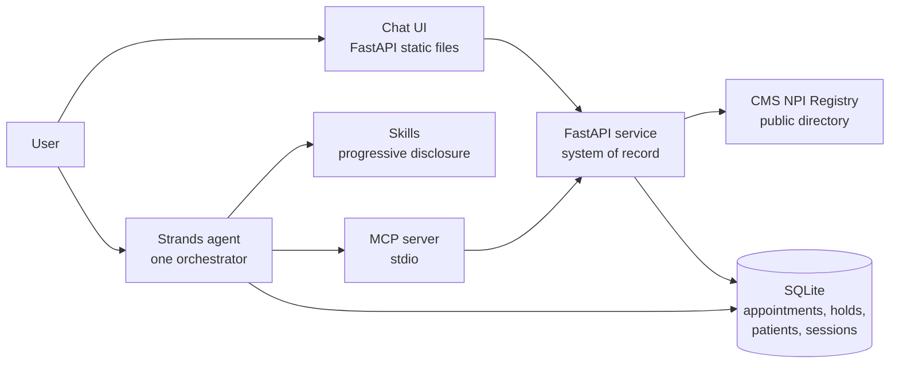

# agent-appointment-scheduler

A production-grade appointment scheduling agent: find a real provider,
book an appointment, change it later — in one long conversation that the
agent actually remembers.

The problem is simple to say and easy to get wrong: a scheduling agent
has to search a real directory, hold a real slot, collect personal
details without leaking them to the model, and keep working when the
user changes their mind mid-flow ("actually, make it Thursday instead").
This repo does all of that with deterministic code doing the deciding
and the model doing the talking.

## Quickstart

```bash
make install          # venv + editable install
make demo-mock        # offline demo, scripted model, no key needed
```

That runs the full multi-turn demo: find a cardiologist near
Minneapolis → pick the second one → Wednesday morning → patient details
(with a phone correction mid-flow) → masked summary → confirm → book →
reschedule to Thursday → resume the session in a fresh agent and ask
"what's my appointment?".

```bash
make demo          # real OpenAI model (needs OPENAI_API_KEY), UI stays up
make demo-gemini   # Gemini free tier (needs GEMINI_API_KEY), UI stays up
make server        # just the service + UI on http://127.0.0.1:8000
make test          # pytest, offline
make eval          # deterministic eval scenarios, offline
```

Keys go in a `.env` file (copy `.env.example`). Never commit it.

## Deploy (Render, free tier)

The repo ships a `render.yaml` Blueprint: connect the repo in the
Render dashboard (New → Blueprint) and it deploys as a public web
service — no credit card, no key needed. It starts in scripted-mock
mode (`SCHEDULER_MOCK=1`), so the whole flow works immediately. For
the live agent, add `GEMINI_API_KEY` in the dashboard and remove
`SCHEDULER_MOCK` (provider is already `gemini`).

Free-tier notes: the instance sleeps after 15 minutes idle (~1 minute
to wake on the next visit) and the SQLite database is ephemeral, so
bookings reset on restart/redeploy.

## How it works



- **Real provider search.** The CMS NPI Registry API (free, no key) is
  queried by taxonomy description — cardiology is "Cardiovascular
  Disease", family medicine "Family Medicine" (the registry has no
  `taxonomy_code` search field and silently ignores it). The registry
  rejects a bare state search, so state is always combined with a city,
  a taxonomy, or a name. Results are cached for 24 hours; if CMS is
  unreachable the demo falls back to a local seed list (marked as such)
  so it never dies.
- **FastAPI scheduling service** (`src/agent_appointment_scheduler/api.py`).
  The system of record: providers, availability (Mon–Fri, 30-minute
  slots, deterministic pseudo-availability), 10-minute slot holds,
  bookings, cancellations, reschedules. SQLite persistence, Pydantic
  validation, structured logging with PII redaction, `/health`.
- **MCP tools** (`mcp_server.py`). The server exposes the tools over
  stdio; the agent loads them through a Strands `MCPClient`. The tools
  call the FastAPI service over HTTP (or in-process ASGI in tests).
- **Strands agent** (`agent.py`). One orchestrator, real model by
  default (OpenAI `gpt-4o-mini`, or Gemini `gemini-3.5-flash-lite` on
  the free tier). Missing key fails fast with a clear message — it
  never silently falls back to the mock model. The scripted model is
  only for tests and `make demo-mock`.
- **Session + memory** (`sessions.py`). A session id per conversation,
  full history persisted in SQLite, resume by id. Three layers:
  working memory (recent turns in context, bounded to 40), episodic
  memory (every turn stored, rolling summary once history passes 12
  turns), semantic memory (durable preferences — mornings,
  Minneapolis, text contact — extracted deterministically).

## How this keeps PHI out of the model

Sensitive values never reach the model. The pattern is
pass-by-reference, the same way credentials are handled: the secret
stays in secure storage, the model only ever sees a handle.

1. When the user gives a name, date of birth, phone, or member ID,
   deterministic code stores it in an encrypted-at-rest patient record
   (SQLite + Fernet field encryption, key from
   `SCHEDULER_ENCRYPTION_KEY` in the environment, never committed).
2. The code returns only an opaque reference (`PAT-...`) plus masked
   values — phone `***-***-4674`, date of birth `**/**/1990`.
3. The agent and its tools carry only the reference and the masked
   values. The FastAPI layer resolves the reference when booking.
4. Logs, traces, and stored conversation history are redacted before
   they are written (`phi.py` — regexes for phone/DOB/member ID plus
   registered literal values from the session).
5. Data minimization: only the fields the booking needs are collected.
   Sessions expire after 30 days; patient records are deletable
   (`DELETE /patients/{ref}`).

There is a test that proves it (`tests/test_phi.py`): a booking turn
runs end to end and the agent's message history and tool arguments are
asserted to contain only the reference and masked forms — the raw phone
and name never appear.

## Form filling

Booking is a slot-filling state machine in deterministic code
(`slots.py`), not in the prompt. The required slots are patient
reference, provider, date/time slot, reason for visit, and contact
method. The session tracks which are filled and which are missing, asks
for one missing piece at a time, validates each answer as it arrives
(Pydantic): natural dates ("next Tuesday" via a deterministic parser),
phone format, and a fresh availability re-check before confirming.
Corrections don't restart the flow — "actually my phone is …" or "make
it Tuesday instead" updates just that slot. Before submitting, the agent
shows a readable summary (PII masked) and asks for explicit
confirmation; only then is `book_appointment` called with
`confirmed=true` and an idempotency key. Where a choice helps, the agent
offers one (morning vs afternoon, first available vs a named provider)
instead of an open-ended question.

## The UI

`make demo` (or `make server`) serves a single-page chat UI from the
same FastAPI app — plain HTML/CSS/JS, no framework, no build step:

- **Chat window** — send a message, see the reply, with the full
  conversation history for the current session.
- **Session picker** — start a new session, or resume an existing one
  (session id + label + last activity). Resuming shows the memory
  working: the booking, the preferences, and where you left off.
- **Booking card** — the current flow state from the session state
  machine: stage, provider, slot, filled/missing form fields, and the
  booking summary (masked PII only, never raw values).
- **Model status** — per-turn prompt tokens, cached tokens, cache hit
  rate, estimated cost saved, and which skills loaded.

The UI talks to the agent through `POST /chat` on the same app
(`{session_id, message}` → reply + updated booking state).

## Design patterns

Every pattern below is in the code — the file and function are listed
so you can check. Nothing here is aspirational.

| # | Pattern | Where | Why this, not the alternative |
|---|---------|-------|-------------------------------|
| 1 | **Simplest effective architecture**: one orchestrator agent + deterministic tools | `agent.py` — `scheduler_agent` | One booking flow, one shared state. A tangle of subagents would split the form state across agents and make "make it Tuesday instead" a cross-agent handoff. A sub-agent is the right call when a task has its own lifecycle and its own state — e.g. a separate insurance-verification agent that runs async and reports back. |
| 2 | **Plan-then-act** | `planner.py` — `plan_for`, `replan`; MCP tool `get_plan` | The agent forms an explicit short plan (search → slots → hold → confirm → book), then executes it. When a tool call fails it replans from the failed step instead of improvising, so a failed availability check doesn't turn into a hallucinated slot. |
| 3 | **Structured outputs everywhere** | `slots.py` — `BookingSummary`, `BookingForm`; `planner.py` — `Plan`/`PlanStep`; `api.py` — Pydantic request/response models | No free-text parsing of anything that decides an outcome. A slot, a phone number, and a booking summary are all validated data, so a bad date or a malformed phone is rejected by code, not argued about by the model. |
| 4 | **Policy-as-code guardrails + human-in-the-loop** | `policy.py` — `check_book`, `check_cancel`, `check_reschedule`; `hooks.py` — `on_before_tool_call` | Confirmation gate, idempotency, no double-booking, and hold expiry are enforced in code before every consequential action. The agent proposes, the policy layer disposes — the same idea as the agent-policy-gateway repo. A prompt-only rule can be talked around; a code check can't. |
| 5 | **Strands-native session management** | `sessions.py` — `SQLiteSessionRepository`; `agent.py` — `RepositorySessionManager` | Strands' own `RepositorySessionManager` persists and restores the agent's messages, so a fresh agent with the same session id resumes with its history (verified with a smoke test during development). The repository is implemented on the same SQLite file as the app's sessions table, so there is one database, not two stores to keep in sync. A hand-rolled store would have duplicated what Strands already does. |
| 6 | **Three-layer memory** | `sessions.py` — `SessionStore` (working: `agent.messages` + `SlidingWindowConversationManager`; episodic: `session_messages` + `maybe_summarize`; semantic: `preferences` + `extract_preferences`) | Working memory is bounded, episodic memory keeps the whole conversation with a rolling summary, semantic memory keeps durable facts. The summary is extractive and deterministic — it never sends raw history to a model, which would leak PII into model context (the reason Strands' `MemoryManager`/`ModelExtractor` was not used: model-based extraction reads the history). |
| 7 | **Lifecycle hooks** | `hooks.py` — `SchedulerHooks` (`BeforeToolCallEvent`, `AfterToolCallEvent`, `AfterModelCallEvent`, `MessageAddedEvent`) | Structured logging with PII redaction, per-turn token/cost accounting (including cache metrics), and guardrail checks on tool calls — all in one place, instead of scattered through the agent code. |
| 8 | **Fallbacks** | `models.py` — `ModelWithFallback`; `chat.py` — `RATE_LIMIT_RETRY_DELAYS`; `cms.py` — cache + seed fallback; `mcp_server.py` — `_call` bounded retries with backoff | A provider failure *before* any content falls back to the other provider mid-turn. A 429 that lands *mid-stream* (the Gemini free tier's 15 req/min limit) can't fall back the same way, so the turn itself retries after a backoff (25s, 30s, 45s) — the live Gemini demo proved this the hard way and `test_chat_retry.py` now covers it. CMS down falls back to cache, then seed; a failed tool call retries twice with backoff. Each layer fails to the next instead of failing the user. |
| 9 | **Observability** | `hooks.py` — `TraceRecorder`; `sessions.py` — traces table | Every turn records session id, tools called, duration, tokens, cost, and latency to SQLite, so a failed booking can be replayed from the log. The demo prints the per-turn accounting; the UI shows it in the Model panel. |
| 10 | **Deterministic evals** | `eval.py` — `make eval` | Five fixed scenarios (find+book, book+reschedule, correction mid-flow, double-book refusal, expired hold) asserting tool calls and final outcomes on the scripted model. No key, no flakiness, no model judgement in the verdict. |
| 11 | **Context engineering** | `sessions.py` — `build_context` (token budget, `CONTEXT_BUDGET_TOKENS`); `prompting.py` — static-prefix layout; `agent.py` — `SlidingWindowConversationManager(window_size=40)` | Explicit token budget for what goes into context, a summarization trigger at 12 turns, and minimal tool schemas. The alternative — stuffing everything in and hoping — is what makes long conversations degrade and cost spiral. |
| 12 | **PHI-by-reference** | `crypto.py` (Fernet), `phi.py` (masking/redaction), `api.py` (`POST /patients`), `mcp_server.py` (`create_patient_record`) | The model never sees raw sensitive values (see the section above). The alternative — trusting the prompt to "not repeat PII" — fails the moment the model is asked to summarize the conversation. |
| 13 | **Skill-based prompts (progressive disclosure)** | `skills/` (`find-providers`, `book-appointment`, `reschedule-cancel`, `session-memory`); `skills.py` — `load_skills`, `select_skills`; `agent.py` — native `AgentSkills` plugin | The agent always carries only the registry (names + one-line descriptions). A skill's full instructions load only when its intent matches, via the native Strands `AgentSkills` plugin and its `skills` tool. One big system prompt would pay for all four skills on every turn and bury the relevant instructions; progressive disclosure keeps the base prompt small and the relevant know-how close. Verified against the installed Strands 1.65.0 (`strands.vended_plugins.skills`). |
| 14 | **Prompt caching** | `prompting.py` — `static_prefix`, `compose_system_prompt`, `extract_cache_metrics`; `hooks.py` — cache metrics in traces | The prompt is built static-first, dynamic-last: the base system prompt is byte-identical across turns, the session id/summary/preferences follow it, and the conversation history is appended at the end. OpenAI caches automatically (≥1,024 prompt tokens) and Gemini caches implicitly (LiteLLM's table lists 1,024 tokens minimum for both; Google's own docs note higher minimums, 2,048+, for some Gemini models). Cache reads cost roughly 10% of normal input price on both. Below the minimum the request is simply processed without caching — no error, no behaviour change. Caching is a cost/latency optimization, not a correctness feature: the agent works identically with caching off. |

## Prompt caching, per provider

Verified from the LiteLLM prompt-caching docs (docs.litellm.ai) and the
providers' own pages, November 2026 — check the current pricing page
before budgeting on these numbers; they move.

| Provider | Behaviour | Minimum | What to check |
|----------|-----------|---------|---------------|
| OpenAI (`gpt-4o-mini`) | Automatic, no annotations. Any prompt ≥1,024 tokens is eligible. | 1,024 prompt tokens | `prompt_tokens_details.cached_tokens` in the usage object |
| Gemini (`gemini-3.5-flash-lite`) | Implicit context caching, on by default for 2.5+ models. No guaranteed saving. | 1,024 tokens per LiteLLM's table; Google's own docs list higher minimums (2,048+) for some models | `usage_metadata.cachedContentTokenCount` |

The hooks report per-turn cache metrics — prompt tokens, cached
tokens, cache hit rate, and estimated cost saved (cached tokens ×
input price × 0.9, since a cache read costs ~10% of a full-price
token) — in the logs, in the traces table, and in the UI's Model
panel. `tests/test_prompting.py` proves the design: the static prefix
is byte-identical across two consecutive turns, and dynamic content is
appended after it.

## Tests

```bash
make test   # pytest, all offline (live tests skipped without keys)
make eval   # the five deterministic eval scenarios
```

Coverage: FastAPI TestClient (booking, double-booking refused, hold
expiry, idempotency, cancel/reschedule, patient encryption), CMS client
with mocked HTTP (including the state-needs-criteria error), session
and memory (resume, summarization trigger, preference recall, token
budget), slot filling (corrections, invalid date/phone, summary-then-
confirm), the PHI proof (LLM context never contains a raw sensitive
value), policy, planner, hooks (guardrail cancellation), fallbacks,
MCP tools over ASGI, multi-turn orchestration with the scripted model,
skill loading, and the prompt-caching layout.

## Free-tier notes

- The CMS NPI Registry API is free with no key.
- Gemini's free tier (`gemini-3.5-flash-lite`, ~500 requests/day
  reported in AI Studio) runs the live demo for $0. Two demo runs back
  to back can hit a 429 (per-minute limit) — wait a minute or two, or
  let the model fallback use OpenAI.
- OpenAI's API is billed separately from a ChatGPT subscription, on
  prepaid credits. A demo run on `gpt-4o-mini` costs pennies — but the
  account needs credits first.

## Retention

Sessions expire after 30 days (`purge_expired`). Patient records are
not purged automatically — they are deleted on request
(`DELETE /patients/{ref}`), so a user can ask for their data to be
removed at any time.
